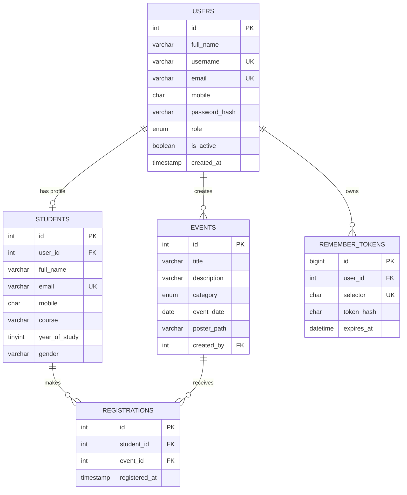

# StudentHub ER Model

`students.user_id` is nullable so administrators can manage standalone student records as well as profiles created through registration. `registrations` has a unique constraint on `(student_id, event_id)` to prevent duplicate event registrations. Passwords and remember-me validators are stored only as hashes.
